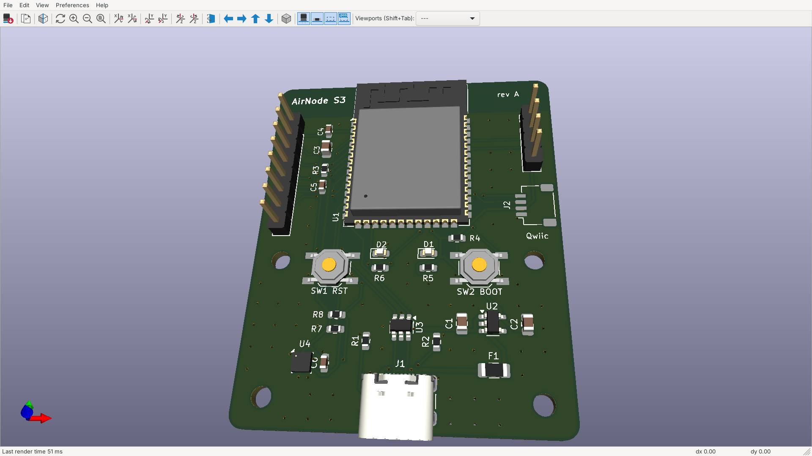

# AirNode S3 — ESP32-S3 Environmental Sensor Node

A compact, USB-C powered Wi-Fi/BLE sensor board: ESP32-S3 module, Bosch BME280 (temperature / humidity / pressure), a Qwiic/STEMMA-QT port for more I2C sensors, a UART debug header and a 6-GPIO breakout.

Designed in **KiCad 7** as a native, self-contained project (local symbol, footprint and 3D libraries), with fabrication and assembly data ready for JLCPCB-class manufacturing.

**Status:** design complete and verified (ERC + DRC clean). Not yet fabricated.

| | |
|---|---|
| Board | 44 × 54 mm, 2 layers, 1.6 mm FR-4, 1 oz copper, 2 mm corner radius |
| Parts | 27 placed (SMD except the two pin headers and the USB-C shell legs), 4 × M2.5 mounting holes |
| Routing | 245 track segments, 120 vias, 0 unrouted |
| Rules | 0.2 mm track/space, 0.6/0.3 mm vias, 0.3 mm copper-to-edge |
| ERC | 0 errors, 0 warnings (1 reviewed exclusion, see below) |
| DRC | 0 violations, 0 unconnected, 0 footprint errors |

---

## Design decisions

### 1. Power input and protection
- **USB-C sink, USB 2.0 only.** 5.1 kΩ pull-downs on CC1/CC2 (R1, R2) make the board a standard sink, so any USB-C charger or port supplies 5 V. No PD controller is needed at this power level.
- **Both D+/D− pairs connected** (A6/B6, A7/B7), so the plug works in either orientation.
- **F1, 500 mA PTC fuse** on VBUS protects the host port and the cable from a board-level short.
- **U3, USBLC6-2SC6 TVS array** sits directly behind the connector and clamps ESD on D+/D− and VBUS before it can reach the ESP32. It is placed as a flow-through (rotated 270°) so the data lines pass straight under it without stubs.

### 2. 3.3 V regulation
- **U2, AP2112K-3.3 LDO:** 600 mA output and 250 mV dropout. Wi-Fi TX bursts on the ESP32-S3 peak at roughly 350 mA, which leaves about 40 % headroom.
- An LDO was chosen over a buck converter: at 5 V in and about 100 mA average, dissipation is around 0.17 W. That is well within SOT-23-5 limits, avoids switching noise near the sensor and antenna, and costs fewer parts.
- **Capacitors:** 10 µF on the input (C1) and output (C2), then 10 µF + 100 nF (C3, C4) at the module's 3V3 pin for Wi-Fi burst current.

### 3. MCU
- **ESP32-S3-WROOM-1-N8** (8 MB flash, PCB antenna, pre-certified module).
- **Native USB** on GPIO19/20 handles both flashing and serial (CDC), so there is no USB-UART bridge chip. That saves cost, area and a failure point.
- **EN:** 10 kΩ + 1 µF RC (R3, C5) delays enable until 3V3 is stable, the reset condition Espressif recommends.
- **Strapping:** BOOT (IO0) has a 10 kΩ pull-up with a button to ground for download mode. RESET is a button on EN.
- **LEDs:** a power LED (green) and a GPIO2 status LED (blue), each with 1 kΩ (about 1.3 mA, enough for an indicator).

### 4. Sensor and I2C
- **BME280 in I2C mode:** CSB is tied high, and SDO is tied low for address 0x76.
- **I2C pull-ups:** 4.7 kΩ on SDA (IO8) and SCL (IO9), shared with the Qwiic connector in standard Qwiic pinout (GND, 3V3, SDA, SCL).
- **Thermal placement.** A board-mounted humidity/temperature sensor reads high if it sits next to heat sources. The BME280 is in the opposite bottom corner from the LDO and well below the ESP32 module.

### 5. Layout
- **Antenna.** The module sits at the top edge with its antenna flush to the board edge. The footprint's keep-out (no copper, tracks, vias or parts on either layer) covers the full width under and beside the antenna, following Espressif's guidance for a PCB-antenna module.
- **Ground strategy.** Both layers are poured with GND. The bottom layer is kept as close to a solid plane as possible: signals use it only to cross, and every SMD ground pad gets its own via to that plane. 53 stitching vias tie the two pours together on a 3 mm grid outside component courtyards.
- **USB routing.** D+ and D− run on the top layer with **zero vias** over the unbroken bottom ground plane, 29.6 mm and 30.4 mm long. At USB Full Speed (12 Mbit/s) a 0.8 mm mismatch is irrelevant; the priorities were short, via-free, referenced to ground and close-coupled.
- **USB-C pad escape.** On 16-pin USB-C the D+/D− pads interleave (D−, D+, D−, D+), so the two pairs can't both leave the pad row on one layer. D+ (A6↔B6) is joined by a short loop under the pad row and D− (B7↔A7) by a bridge above it, so both pairs exit cleanly with no vias.
- **Track widths by netclass:**
  - VBUS / VBUS_IN: 0.4 mm
  - +3V3 / GND: 0.3 mm
  - signals and USB: 0.2 mm (USB at 0.2 mm to fit the 0.5 mm-pitch connector pads)
- **Pad connections.** SMD pads connect to the pours solidly (better for reflow); through-hole pads use thermal reliefs (better for hand soldering).

### 6. Manufacturability (DFM)
- **ESP32 thermal vias opened from 0.2 to 0.3 mm.** Espressif's footprint uses 0.2 mm vias under the module's ground pad. The project's local copy uses 0.3 mm, JLCPCB's standard 2-layer minimum, so the board needs no advanced-process surcharge.
- **USB-C peg clearance.** In the GCT USB4105 land pattern, the connector's alignment-peg holes sit 0.19 mm from its outer ground pads. That is the manufacturer's geometry, so a scoped DRC rule (`airnode.kicad_dru`) relaxes hole clearance **for J1 only** rather than loosening the board-wide rule.
- **Silkscreen.**
  - Every legend stays off pads and inside the board edge.
  - Header pin names are on the bottom silkscreen, readable when the board is flipped to wire it.
  - The module's antenna-end silkscreen is pulled 0.5 mm inside its outline so it never crosses the board edge.
- **Assembly files.**
  - The BOM groups parts and lists manufacturer part numbers.
  - The pick-and-place (CPL) file is in JLCPCB's format.
  - Mounting holes are excluded from both.

### 7. Verification
- **ERC:** run in the KiCad 7 schematic editor.
  - 0 errors.
  - One warning reviewed and excluded: *"Bidirectional pin connected to power output"* on the BME280's SDO. SDO is deliberately strapped to GND to select address 0x76, and the GND net carries a PWR_FLAG, so this is a false positive by design.
- **DRC:** KiCad 7 DRC with all track errors reported. 0 violations, 0 unconnected pads, 0 footprint/library mismatches.
- **Netlist audit:** the exported netlist was compared pin by pin against the design intent (23 nets) and matches exactly.

---

## Files

| Path | Contents |
|---|---|
| `airnode.kicad_pro / .kicad_sch / .kicad_pcb` | KiCad 7 project, schematic, board |
| `airnode.kicad_sym`, `airnode.pretty/`, `airnode.3dshapes/` | Project-local symbol, footprint and 3D-model libraries (opens on any machine) |
| `sym-lib-table`, `fp-lib-table`, `airnode.kicad_dru` | Library tables and the scoped custom DRC rule |
| `fab/airnode-gerbers.zip` | Gerbers + Excellon drill + drill map, ready to upload |
| `fab/airnode-bom.csv`, `fab/airnode-cpl.csv` | Assembly BOM and pick-and-place (JLCPCB format) |
| `fab/airnode.step` | Full 3D STEP model for mechanical / enclosure work |
| `docs/` | Schematic PDF, assembly drawing, layout PDF, ERC and DRC reports, netlist |
| `images/` | Renders and KiCad screenshots |

## Ordering
1. Upload `fab/airnode-gerbers.zip` and keep the defaults: 2 layers, 1.6 mm, HASL or ENIG.
2. For assembly, upload `airnode-bom.csv` and `airnode-cpl.csv`, then match each line to the fab's parts catalogue. Generic resistors, capacitors and LEDs can use any equivalent 0603/0805 part.
3. Check part rotations in the assembler's preview before confirming. Rotation conventions differ between libraries.

## Not included / next revision
- The KiCad 7 library has no 3D model for the JST-SH Qwiic connector, so it appears as bare pads in the 3D view.
- **Possible rev B:**
  - battery input with a charger (TP4056 or MCP73831) and power-path switching
  - a deep-sleep current-measurement jumper
  - a thermal slot around the BME280
